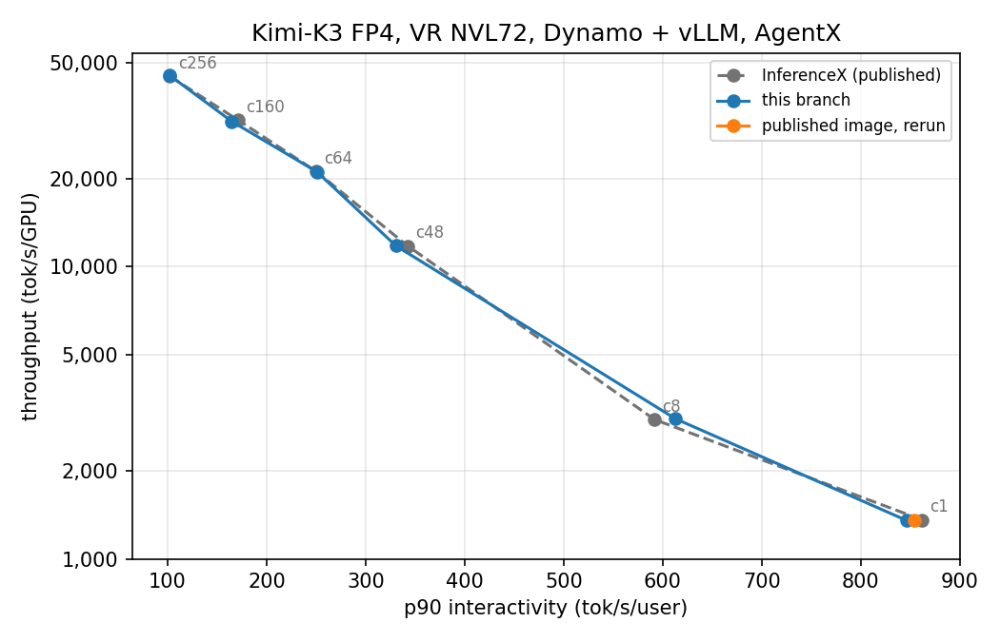

# Kimi-K3 on Vera Rubin NVL72: reproduce the InferenceX Dynamo + vLLM AgentX Pareto

This folder reproduces the six published **Vera Rubin NVL72 (Dynamo vLLM)** Kimi-K3
AgentX points of [InferenceX](https://inferencex.semianalysis.com/infx/inference/kimi-k3)
with the vLLM code on this branch (`kimi-k3-vr`).

It was verified end to end on a VR NVL72 rack. All six points came out within 4% of the
published values: p90 interactivity from -3.9% to +3.6%, throughput per GPU from -0.9% to
+0.7%. GSM8K and InferenceX's tool-call schema eval pass. Details are in [Results](#results).

## What runs

One disaggregated Dynamo deployment per point, all FP4 Kimi-K3 with the DSpark drafter,
FP8 KV cache, BF16 Mamba state, MLA with decode context parallelism (DCP):

| Point | Prefill workers | Decode worker | Nodes | Draft tokens | KV between prefill and decode | Host KV cache |
| --- | --- | --- | --- | --- | --- | --- |
| c1, c8 | 1 x TP8/DCP8/EP8 (2 nodes) | 1 x TP16/DCP16 (4 nodes) | 6 | 7 | NIXL | none |
| c64 | 1 x TP8/DCP8/EP8 | 1 x TP16/DCP16 | 6 | 7 | NIXL | Mooncake store, 160 GB/node |
| c48 | 2 x TP8/DCP8/EP8 (4 nodes) | 1 x TP16/DCP16, max 64 seqs | 8 | 3 | NIXL | Mooncake store, 160 GB/node |
| c160, c256 | 2 x TP8/DCP8/EP8 | 1 x TP16/DCP16, max 128 seqs | 8 | 3 | NIXL | Mooncake store, 200 GB/node |

- The workload is InferenceX **AgentX**: multi-turn agentic coding traces
  (`semianalysisai/cc-traces-weka-062126`, inputs up to about 1M tokens, 1K output tokens),
  one fixed concurrency per deployment, a 60-minute measured window, conversation-affine routing.
- Speculative decoding uses InferenceX's synthetic acceptance: the DSpark drafter runs, but
  acceptance follows the committed golden curve (3.84 tokens per step with 7 draft tokens,
  3.00 with 3), so results compare across submissions.
- The recipe and its InferenceX configuration entry ship in [inferencex/](inferencex)
  (`disagg-p8-d16-variants.yaml`, `kimik3-vrnvl72.yaml`);
  [setup_inferencex.py](setup_inferencex.py) installs them into a clone of the public
  InferenceX repository, whose launcher runs every point.

## How the image is built

The published points were measured with an image made of two parts:

1. **vLLM's release image of upstream commit `3f1bcfd82`** for aarch64 with CUDA 13.4,
   built by vLLM's release pipeline from this repository's `docker/Dockerfile` (job "Build
   release image - aarch64 - Rubin CUDA 13.4" in `.buildkite/release-pipeline.yaml`) and
   published as `public.ecr.aws/q9t5s3a7/vllm-release-repo:3f1bcfd82bb2e93fcd364fc7a5491718453a77e2-aarch64-cu134`.
2. **A Kimi-K3 layer under `/opt/k3`**: per-role vLLM overlays (`/opt/k3/ov-*`, which this
   branch replaces), four builds of Dynamo 1.5.0 the recipe puts on `PYTHONPATH`, the
   Mooncake memory lender (`bin/dloan.sh`), a decode CPU-pinning hook (`pinhook`), a CuTe
   compile-cache hook (`startup-hook`) and the frontend's tokenizer view (`fe-hf-view`).

This branch is upstream `3f1bcfd82` plus the Kimi-K3 commits, and those commits change only
Python: the two new CUDA ops (FlashKDA segment scan for prefill, MLA QKV quantization
epilogue) are built just in time by `torch.utils.cpp_extension` at first use (about 40 s
and 20 s on a VR GPU). So [build_image.sh](build_image.sh) starts from the release image,
checks that its `vllm` package is the upstream snapshot (all 2,668 Python files
byte-identical), patches in this branch's changed files, and adds `/opt/k3` from
[image/](image): Dynamo 1.5.0 from its public PyPI wheels with the patches in
[image/dynamo](image/dynamo), and the scripts in [image/opt-k3](image/opt-k3) (copied
unchanged from the published image). No overlay is installed, so every process imports
this branch. The recipe still puts the frontend overlay `/opt/k3/ov-fe-conv` on the
frontend's `PYTHONPATH`; Python skips the missing directory, and the one module only that
overlay had (a conversation router, enabled by `DYN_CONV_ROUTER`) is not used by these
recipes.

Building the release image itself from this repository is future work; see
[Future work](#future-work-build-the-base-image-from-source).

## Prerequisites

- VR NVL72 nodes under Slurm with Pyxis/enroot, which InferenceX's launcher uses. Each job
  needs 6 or 8 nodes in one NVLink domain: decode TP16 spans 4 nodes over multi-node NVLink.
- A directory `<IMAGE_DIR>` for images, on storage every node sees, and internet access from
  the compute nodes (public container registries, PyPI) and from the login node (PyPI).
- A Hugging Face hub cache `<HF_HUB_CACHE>` on storage every node sees, holding
  `moonshotai/Kimi-K3` (revision `a590ce09`) and the dataset
  `semianalysisai/cc-traces-weka-062126`. With `HF_HUB_CACHE=<HF_HUB_CACHE>`:
  `hf download moonshotai/Kimi-K3 --revision a590ce090cb049c93a33dfe8c208ec652aa20503` and
  `hf download --repo-type dataset semianalysisai/cc-traces-weka-062126`.
- The DSpark drafter `Inferact/Kimi-K3-DSpark` (revision `cf6b8244`, 7.1 GB) as a plain
  directory `<DSPARK_DIR>` (not a hub snapshot): `hf download Inferact/Kimi-K3-DSpark
  --revision cf6b8244620e7ea4b0651d214f28e89eac75bed6 --local-dir <DSPARK_DIR>`. The recipes
  name it by the container path `/raid/common-models/kimi-k3-dspark`; the cluster record
  mounts `<DSPARK_DIR>` there.
- A directory `<AIPERF_CACHE_DIR>` for the benchmark client's dataset cache.
- `git` and `uv` on the login node, for a clone of the public InferenceX repository
  (step 3).

## Step by step

### 1. Build the image from this branch

From the repository root, on a login node:

```bash
SLURM_ACCOUNT=<SLURM_ACCOUNT> SLURM_PARTITION=<SLURM_PARTITION> OUT_DIR=<IMAGE_DIR> \
  bash examples/vr_k3/build_image.sh      # prints IMAGE=vllm-k3-vr-branch-<sha>
```

It stages this branch's `vllm/` changes and `/opt/k3` on the login node, then runs one job
on a compute node that pulls the release image, applies them and saves
`<IMAGE_DIR>/vllm-k3-vr-branch-<sha>.sqsh` (about 5 minutes once the job starts). The
image records its sources in `/opt/k3/provenance/BRANCH`.

The release image lives in vLLM's CI image registry, which drops old images after some
weeks. Keep a copy, and build from it with `BASE_IMAGE=<IMAGE_DIR>/vllm-release-3f1bcfd82-aarch64-cu134.sqsh`:

```bash
NVIDIA_VISIBLE_DEVICES=void srun -N1 -A <SLURM_ACCOUNT> -p <SLURM_PARTITION> \
  --container-image='public.ecr.aws#q9t5s3a7/vllm-release-repo:3f1bcfd82bb2e93fcd364fc7a5491718453a77e2-aarch64-cu134' \
  --container-env=NVIDIA_VISIBLE_DEVICES --no-container-mount-home \
  --container-save=<IMAGE_DIR>/vllm-release-3f1bcfd82-aarch64-cu134.sqsh true
```

### 2. Smoke-test it on one node

```bash
sbatch -N1 --exclusive -t 00:45:00 -A <SLURM_ACCOUNT> -p <SLURM_PARTITION> \
  --export=ALL,IMAGE=<IMAGE_DIR>/vllm-k3-vr-branch-<sha>.sqsh,OUT=/path/to/smoke \
  examples/vr_k3/smoke_test.sh
```

It builds the JIT ops on a VR GPU, imports the model, the branch-only modules and both
Dynamo builds, and runs the 1,596 unit tests this branch adds or changes (about 20 minutes).
They need internet access for two small public test models.

### 3. Set up the InferenceX launcher

Clone the public InferenceX repository at the commit this tutorial was run with; its
`inferencex-e2e` directory is `<INFX_DIR>` below:

```bash
git clone https://github.com/SemiAnalysisAI/InferenceX.git
cd InferenceX && git checkout 80dff120d27fd6092210f4546b8faa5e6c9723ac
git submodule update --init inferencex-e2e/utils/srt-slurm
cd inferencex-e2e && uv sync --locked
.venv/bin/python /path/to/vllm/examples/vr_k3/setup_inferencex.py . \
  --partition <SLURM_PARTITION> --account <SLURM_ACCOUNT> \
  --hf-hub-cache <HF_HUB_CACHE> --aiperf-cache-dir <AIPERF_CACHE_DIR> \
  --image-dir <IMAGE_DIR> --dspark-dir <DSPARK_DIR>
```

[setup_inferencex.py](setup_inferencex.py) installs the Kimi-K3 VR recipe and its
configuration entry from [inferencex/](inferencex), applies
[inferencex/collect.patch](inferencex/collect.patch) (the launcher then collects AgentX
results from the job's `logs/agentic` directory), adds a cluster record `vrnvl72-local` to
`configs/runners.yaml` with runner names `vrnvl72-local_0` .. `_7`, and adds its lane to
`infx/launch/drivers/srt/lanes.py`. Running it again changes nothing. Two options depend on
how your Slurm is set up: `--no-gpu-gres` when the nodes define no GPU GRES (jobs are
exclusive, so each still gets all 4 GPUs), and `--segment` when Slurm needs `--segment` to
place a job's nodes in one NVLink domain.

### 4. Run the Pareto

```bash
export INFX_DIR=<INFX_DIR> K3VR_WORK=/path/to/work
bash examples/vr_k3/run_pareto.sh vllm-k3-vr-branch-<sha>
bash examples/vr_k3/status.sh          # one line per point
```

Each point is one Slurm job driven by InferenceX's own launcher (`python -m infx.launch run`,
started by [run_point.py](run_point.py) with the environment InferenceX's workflow sets).
Servers take 30 to 50 minutes to start (decode is slowest), then the client warms up and
measures for 60 minutes: a job takes 1 h 35 min (c1) to 2 h 20 min (c256). A point's
result is `$K3VR_WORK/runs/<run>/<result name>_conc<N>.json`; server logs are in `LOGS/`.

To check accuracy, run InferenceX's two evals as eval-only jobs. They use the recipe's eval
variant, which verifies draft tokens for real instead of the synthetic acceptance and turns
on the Kimi tool-call parser, so the scores reflect the model's own output. Each job takes
about 30 minutes, mostly server startup:

```bash
# GSM8K (lm-eval, 1,319 questions) on the c64 deployment
python examples/vr_k3/run_point.py kimik3_p1x8ep8_d1x16_conc64_kvdram-mooncake \
  --eval-only --image vllm-k3-vr-branch-<sha> --tag eval --runner 6
# kimi-vendor tool-call schema suite (204 cases, each streamed and non-streamed) on the c8 deployment
python examples/vr_k3/run_point.py kimik3_p1x8ep8_d1x16_conc8 \
  --eval-only --image vllm-k3-vr-branch-<sha> --tag eval --runner 7
```

Scores are in each run directory's `results_*.json`. From that directory,
`$INFX_DIR/.venv/bin/python -m infx.evals.validate_scores --results-glob 'results_*.json'
--meta-env meta_env.json` applies InferenceX's thresholds: 0.90 for GSM8K; the tool-call
suite is diagnostic (threshold 0), but a request the server rejects fails it.

InferenceX's workflow also runs the tool-call suite after each point's benchmark, against
the benchmark servers. This tutorial does not. Those servers use synthetic acceptance and
the recipe's benchmark variant, without structural tags, and there one schema case is
rejected (see [Troubleshooting](#troubleshooting)). The structured-output code is the same
in the published image, so expect the same there.

### 5. Compare with InferenceX

```bash
python examples/vr_k3/summarize.py $K3VR_WORK/runs   # table and pareto.png vs inferencex_vr_targets.json
```

## Results

One run per point on a VR NVL72 rack, with an image of this branch (commit `f00041e`) whose
`vllm` package and `/opt/k3` contents are file for file what `build_image.sh` makes. c1 was
also rerun with the published image, to separate the rack from the code. Output of
`summarize.py`:

| Series | Conc | GPUs | p90 interactivity (tok/s/user) | InferenceX | diff | tok/s/GPU | InferenceX | diff | TTFT p50 / p90 (s) | requests measured | errors |
| --- | ---: | ---: | ---: | ---: | ---: | ---: | ---: | ---: | --- | ---: | ---: |
| this branch | 1 | 24 | 846.8 | 862.1 | -1.8% | 1,351.0 | 1,359.3 | -0.6% | 0.28 / 0.43 | 429 | 13 (2.9%) |
| this branch | 8 | 24 | 612.8 | 591.7 | +3.6% | 3,016.4 | 2,998.1 | +0.6% | 0.18 / 0.33 | 1,491 | 68 (4.3%) |
| this branch | 48 | 32 | 330.6 | 342.5 | -3.5% | 11,779.3 | 11,769.4 | +0.1% | 0.31 / 0.75 | 8,360 | 429 (4.8%) |
| this branch | 64 | 24 | 250.7 | 250.0 | +0.3% | 21,107.1 | 21,174.1 | -0.3% | 0.38 / 1.14 | 12,087 | 571 (4.5%) |
| this branch | 160 | 32 | 164.6 | 171.2 | -3.9% | 31,423.5 | 31,704.8 | -0.9% | 0.65 / 1.51 | 24,411 | 1,373 (5.2%) |
| this branch | 256 | 32 | 102.2 | 102.3 | -0.1% | 45,062.4 | 44,755.1 | +0.7% | 1.06 / 3.51 | 36,428 | 2,237 (5.7%) |
| published image, rerun | 1 | 24 | 854.2 | 862.1 | -0.9% | 1,357.5 | 1,359.3 | -0.1% | 0.23 / 0.37 | 438 | 13 (2.9%) |



The measured points are in [results/results.csv](results/results.csv). "Requests measured"
excludes the warmup period and failed requests; every failure was `InvalidInferenceResultError`
(see [Troubleshooting](#troubleshooting)).

Accuracy, with the evals InferenceX schedules, both as eval-only jobs on this branch's image:

| Eval | Deployment | Score | InferenceX threshold |
| --- | --- | ---: | ---: |
| GSM8K (lm-eval, 1,319 questions, 5-shot), real draft verification | c64 (1 prefill, 1 decode, Mooncake) at concurrency 64 | 0.967 strict, 0.967 flexible | 0.90 |
| `kimi_tool_call_schema_full` (204 cases, each streamed and non-streamed) | c8 (1 prefill, 1 decode) at concurrency 8 | 0.985 (402 of 408) | 0 (diagnostic) |

In the six failed tool-call checks the model answered without a tool call.

## What had to be fixed

In this branch:

- **NIXL pulls left stale bytes in host-memory KV caches**
  (`[KV Connector][NIXL] Zero unwritten pull pages in host-memory KV caches too`). The pull
  worker zeroes the attention pages a pull does not write (the scheduler skips their
  allocation-time zeroing), but its page zeroer ignored every KV cache tensor on the CPU.
  It now skips only a host cache shared across ranks, which rank 0 writes. GPU caches were
  never affected, so the performance runs are unchanged; it made 122 of the 220 cases of
  `tests/v1/kv_connector/unit/test_nixl_desc_geometry.py` fail.

In the recipe ([inferencex/disagg-p8-d16-variants.yaml](inferencex/disagg-p8-d16-variants.yaml)),
relative to the one behind the published points:

- **The drafter's host path was hard-coded** (`extra_mount:
  /raid/common-models/kimi-k3-dspark`), so the recipe only ran where that directory exists
  on every node. The recipe keeps the container path; each cluster record now mounts its
  own drafter directory there.
- **The declared vLLM identity did not match the image** (`c88d36d26f`), so every run's
  identity check reported a mismatch. It now declares what the image reports,
  `0.32.0rc1.dev190+g3f1bcfd82.d20261015.cu134`. Images built by `build_image.sh` report
  the same version string (only the Python files change); their source commit is in
  `/opt/k3/provenance/BRANCH`.

## Troubleshooting

| Symptom | Cause and fix |
| --- | --- |
| `sbatch: error: Invalid generic resource (gres) specification` | The nodes define no GPU GRES. Run `setup_inferencex.py` again with `--no-gpu-gres`. |
| NCCL or MNNVL errors at decode start, or decode slower than expected | The job's nodes are not in one NVLink domain. If your Slurm places jobs in NVLink domains with `--segment`, run `setup_inferencex.py` again with `--segment`. |
| Benchmark exits 127: `/infmax-workspace/benchmarks/srt_agentic.sh: No such file or directory` | The launch workspace is mounted into the job as `/infmax-workspace`; symlinks out of it do not resolve. `run_point.py` copies the launcher tree into each run directory. |
| `ERROR: Missing srt-slurm submodule` | Run `git submodule update --init utils/srt-slurm` in `<INFX_DIR>`. |
| `build_image.sh` stops with `the image's vLLM is not this branch's upstream snapshot` | `BASE_IMAGE` is not vLLM's release image of the upstream commit. Use the default or a saved copy of it. |
| Unit tests fail with `Invalid repository ID or local directory specified: 'facebook/opt-125m'` | The tests download small public models; the smoke test needs internet access from the node. |
| `Unknown vLLM environment variable detected: VLLM_KIMI_K3_DS_T2P` (and `..._DS_LPC`) | Harmless. The recipe sets both to 0 for the published image; this branch does not have those features. |
| `!! frameworks.vllm: expected ...` in the identity check | Informational. The recipe declares the version the image reports. |
| A job's host setup fails with `memory clock != 4752 MHz` | The recipe's host check (`host_setup` in `inferencex/disagg-p8-d16-variants.yaml`) requires every GPU's memory clock at 4752 MHz, the condition the published points were measured under. |
| Mooncake clients fail to start or mount (`dloan` logs under the run's `LOGS/`) | The recipe names the RDMA devices the Mooncake memory lender uses (`DLOAN_NICS0`, `DLOAN_NICS1` in `inferencex/disagg-p8-d16-variants.yaml`). Set them to your nodes' devices (`ibv_devices`). |
| 3 to 6% of requests fail as `InvalidInferenceResultError` (no content), more at higher concurrency | The published image does the same: at c1, 13 errors in 451 requests, against 13 in 442 with this branch. Failed requests are left out of the metrics, as in InferenceX. |
| `validate_scores`: `FAIL: integration failure: ... endpoint request or response failure(s)` for `kimi_tool_call_schema_full` | The tool-call suite ran against benchmark servers (InferenceX's eval after the benchmark). Case `TestBasicTypes:4` is rejected there: "No compatible structured output backend was found" (XGrammar rejects the schema, and Guidance does not support the Kimi tokenizer). Run the suite as an eval-only job (`--eval-only`), which uses the eval variant with structural tags. |
| No server after 30 minutes | Normal: decode captures many CUDA graph sizes and JIT-compiles its CuTe kernels. Measured: 28 to 29 min (c1, c8, c64), 33 min (c48), 49 min (c160, c256). The health check waits up to 2 hours. |

How close to expect: at every point, p90 interactivity landed within 4% of InferenceX and
throughput per GPU within 1%. A p90 moves with a few slow requests, so read a few percent of
interactivity difference as noise and check throughput per GPU first.

## Future work: build the base image from source

The base image is vLLM's release image of commit `3f1bcfd82`, built by vLLM's release
pipeline from this repository's `docker/Dockerfile` (target `vllm-openai`) with the
arguments of the job "Build release image - aarch64 - Rubin CUDA 13.4" in
`.buildkite/release-pipeline.yaml`. Rebuilding it from this checkout, for when the registry
no longer has it, is not part of this tutorial yet: it needs Docker with BuildKit (the
Dockerfile uses cache and bind mounts), or the Dockerfile's steps reproduced in Pyxis
containers, and neither path has been verified here. Until then, keep a copy of the
release image (step 1).
